# Entity-Relationship (ER) Diagram - FUNCH Car Rental System

เอกสารแสดงโครงสร้างฐานข้อมูลและแผนภาพแสดงความสัมพันธ์ของข้อมูล (Entity-Relationship Diagram) สำหรับระบบบริการเช่ารถยนต์ **FUNCH** โดยอ้างอิงจากข้อกำหนดใน `Assignment.md`, โครงสร้าง `schema.prisma`, และโครงสร้างรุ่นรถและข้อเสนอรายสาขา ใน `backend/docs/cars.md`

---

## 1. แผนภาพความสัมพันธ์เชิงแนวคิด (Mermaid ER Diagram)

```mermaid
erDiagram
    COUNTRY ||--o{ LOCATION : "operates_in"
    COUNTRY ||--o{ CAR : "registers"
    
    LOCATION ||--o{ CAR_MODEL_LOCATION : "offers_at_branch"
    CAR_MODEL ||--o{ CAR_MODEL_LOCATION : "defines_specs"
    
    LOCATION ||--o{ CAR : "currently_parked_at"
    CAR_MODEL_LOCATION ||--o{ CAR : "assigned_cars"
    
    USER ||--o{ BOOKING : "places_as_customer"
    USER ||--o{ BOOKING : "reviews_as_admin"
    
    CAR ||--o{ BOOKING : "allocated_to"
    CAR_MODEL_LOCATION ||--o{ BOOKING : "booked_offer"
    
    LOCATION ||--o{ BOOKING : "pickup_location"
    LOCATION ||--o{ BOOKING : "dropoff_location"
    
    CAR ||--o{ CAR_MOVEMENT : "movement_history"
    LOCATION ||--o{ CAR_MOVEMENT : "from_location"
    LOCATION ||--o{ CAR_MOVEMENT : "to_location"
    BOOKING ||--o| CAR_MOVEMENT : "triggers_transfer"

    COUNTRY {
        string code PK "ISO 2-letter country code (TH, JP, US)"
        string name "Country name (EN)"
        string nameTh "Country name (TH)"
        string flag "Flag icon or emoji"
        string currencyCode "Local currency (THB, JPY, USD)"
        string drivingSide "Driving side (LEFT, RIGHT)"
    }

    LOCATION {
        uuid id PK "Location ID"
        string countryCode FK "References Country(code)"
        string name "Location name (EN)"
        string nameTh "Location name (TH)"
        string city "City (EN)"
        string cityTh "City (TH)"
        string timeZone "IANA timezone (e.g. Asia/Bangkok)"
        string airportCode "Airport IATA code (BKK, HND)"
    }

    USER {
        uuid id PK "User ID"
        string email UK "User login email"
        string password "Hashed password (bcrypt)"
        string name "Display name"
        string firstName "First name"
        string lastName "Last name"
        string phoneNumber "Contact telephone number"
        string role "Role (USER, ADMIN)"
        boolean isActive "Active status flag"
        int sessionVersion "Session invalidation counter"
        datetime createdAt "Created timestamp"
        datetime updatedAt "Updated timestamp"
    }

    CAR_MODEL {
        uuid id PK "Model specification ID"
        string brand "Vehicle brand (Toyota, Honda, Tesla)"
        string model "Model line (Camry, Civic, Model 3)"
        int year "Manufacturing year"
        int seats "Passenger seating capacity"
        string transmission "Transmission (Automatic, Manual)"
        string fuelType "Fuel type (Gasoline, EV, Hybrid)"
        string steeringSide "Steering side (RHD, LHD)"
        string transmissionType "Transmission enum (AUTOMATIC, MANUAL)"
        int luggageCapacity "Luggage capacity (suitcases)"
        string[] categories "Categories array (SUV, SEDAN, EV, etc.)"
        string[] featureCodes "Feature tags (GPS, DASHCAM, ISOFIX)"
        string categoryLabel "Primary display category"
        float rating "Average review rating"
        int reviewCount "Total review count"
        string badge "Highlight badge (e.g. POPULAR)"
        boolean isFeatured "Featured vehicle on home page"
        int recommendationOrder "Sorting order index"
        string imageUrl "Cover image URL"
        json options "Display amenities and specs"
        string description "Detailed description text"
        datetime createdAt "Created timestamp"
        datetime updatedAt "Updated timestamp"
    }

    CAR_MODEL_LOCATION {
        uuid id PK "Model-Branch Offer ID"
        uuid carModelId FK "References CarModel(id)"
        uuid locationId FK "References Location(id)"
        string providerName "Car rental provider"
        decimal hourlyRate "Rental rate per hour (THB)"
        decimal dailyRate "Rental rate per day (THB)"
        string currencyCode "Currency code (THB)"
        boolean isActive "Active for public booking"
        int turnaroundMinutes "Turnaround prep time (mins)"
        datetime createdAt "Created timestamp"
        datetime updatedAt "Updated timestamp"
    }

    CAR {
        uuid id PK "Physical car inventory ID"
        string licensePlate "License plate string"
        string country FK "Registered country code (Unique with plate)"
        uuid locationId FK "Current physical location"
        uuid carModelLocationId FK "Assigned branch offer"
        string brand "Compatibility mirror: Brand"
        string model "Compatibility mirror: Model"
        int year "Compatibility mirror: Year"
        decimal hourlyRate "Compatibility mirror: Hourly rate"
        decimal dailyRate "Compatibility mirror: Daily rate"
        string currencyCode "Currency (THB)"
        int seats "Seating capacity"
        string transmission "Transmission label"
        string fuelType "Fuel type"
        string operationalStatus "Status (AVAILABLE, CLEANING, MAINTENANCE, INACTIVE)"
        boolean isAvailable "Active booking flag"
        string exteriorColor "Body paint color"
        int odometerKm "Current odometer reading (KM)"
        string vin "Vehicle Identification Number"
        datetime availableFrom "Ready timestamp after turnaround"
        string steeringSide "Steering side (RHD, LHD)"
        string transmissionType "Transmission enum"
        int luggageCapacity "Luggage capacity"
        string[] categories "Category tags"
        string[] featureCodes "Feature tags"
        datetime createdAt "Created timestamp"
        datetime updatedAt "Updated timestamp"
    }

    BOOKING {
        uuid id PK "Booking ID"
        string bookingNumber UK "Human-readable reference (cuid)"
        uuid userId FK "Customer User ID"
        uuid carId FK "Allocated physical vehicle"
        uuid carModelLocationId FK "Selected branch offer"
        uuid pickupLocationId FK "Pickup branch location"
        uuid dropoffLocationId FK "Dropoff branch location"
        uuid approvedById FK "Admin user who approved/reviewed"
        datetime startDateTime "Rental pickup time (UTC)"
        datetime endDateTime "Rental dropoff time (UTC)"
        int calculatedDays "Charged days count"
        int calculatedHours "Charged hours count"
        decimal totalPrice "Final calculated rental price"
        json pricingDetails "Rule breakdown log"
        decimal hourlyRate "Rate snapshot per hour"
        decimal dailyRate "Rate snapshot per day"
        string currencyCode "Charged currency (THB)"
        string timeZone "Pickup location timezone used for pricing"
        string driverName "Lead driver full name"
        string internationalDrivingPermit "IDP permit number"
        string status "Status (PENDING, APPROVED, REJECTED, CANCELLED, COMPLETED)"
        string source "Source (EXISTING_MEMBER, REGISTER_AND_BOOK)"
        int turnaroundMinutes "Turnaround buffer minutes applied"
        json carSnapshot "Car specifications snapshot"
        string adminNote "Approval or rejection remarks"
        datetime reviewedAt "Review timestamp"
        datetime createdAt "Booking created timestamp"
        datetime updatedAt "Booking updated timestamp"
    }

    CAR_MOVEMENT {
        uuid id PK "Movement log ID"
        uuid carId FK "Physical car moved"
        uuid bookingId UK "Related booking (if one-way dropoff)"
        uuid fromLocationId FK "Origin branch (null if factory/new)"
        uuid toLocationId FK "Destination branch"
        datetime occurredAt "Execution timestamp"
        string reason "Reason (COMPLETED_BOOKING, REBALANCE, RELOCATION)"
        string note "Admin remarks"
    }
```



---

## 2. คำอธิบายเอนทิตีและตาราง (Entity & Data Dictionary)

### 2.1 กลุ่มโครงสร้างภูมิศาสตร์และสาขา (Geography & Branches)

#### `Country` (ตาราง `countries`)
เก็บบัญชีรายชื่อประเทศที่ระบบเปิดให้บริการ รองรับการจองรถทั่วโลกตามเงื่อนไขใน Requirement
- **`code` (PK)**: รหัสประเทศ ISO 3166-1 alpha-2 ขนาด 2 ตัวอักษร เช่น `TH`, `JP`, `US`, `GB`
- **`name` / `nameTh`**: ชื่อประเทศภาษาอังกฤษและภาษาไทย
- **`flag`**: สัญลักษณ์หรือไอคอนธงชาติ
- **`currencyCode`**: สกุลเงินท้องถิ่นของประเทศนั้นๆ
- **`drivingSide`**: ทิศทางเลนจราจร (`LEFT` ขับชิดซ้าย เช่น ไทย ญี่ปุ่น อังกฤษ / `RIGHT` ขับชิดขวา เช่น สหรัฐฯ ยุโรป) เพื่อแจ้งเตือนลูกค้าในการเลือกประเภทพวงมาลัย

#### `Location` (ตาราง `locations`)
เก็บบัญชีสาขาจุดรับ-คืนรถยนต์ในแต่ละเมืองหรือสนามบิน
- **`id` (PK)**: รหัสสาขา (UUID)
- **`countryCode` (FK)**: เชื่อมโยงกับ `Country.code`
- **`name` / `nameTh`**: ชื่อสาขา (เช่น Suvarnabhumi Airport, Haneda Airport)
- **`city` / `cityTh`**: เมืองที่ตั้ง
- **`timeZone`**: เขตเวลา IANA ของสาขานั้น เช่น `Asia/Bangkok`, `Asia/Tokyo`, `America/Los_Angeles` เพื่อใช้คำนวณกฎราคาคืนรถหลัง 14:00 น. และแปลงเวลาเป็น UTC ได้อย่างถูกต้อง
- **`airportCode`**: รหัสสนามบิน IATA 3 ตัวอักษร เช่น `BKK`, `HND`, `LAX` (ถ้ามี)

---

### 2.2 กลุ่มผู้ใช้งานและสิทธิ์ (Users & Authentication)

#### `User` (ตาราง `users`)
เก็บบัญชีผู้ใช้งานระบบ ทั้งลูกค้าทั่วไปและผู้ดูแลระบบ (Admin)
- **`id` (PK)**: รหัสผู้ใช้ (UUID)
- **`email` (UK)**: อีเมลประจำตัวผู้ใช้ (ห้ามซ้ำ)
- **`password`**: รหัสผ่านที่เข้ารหัสด้วย bcrypt
- **`name` / `firstName` / `lastName`**: ชื่อสำหรับแสดงผลและชื่อ-นามสกุลจริง
- **`phoneNumber`**: เบอร์โทรศัพท์สำหรับติดต่อ
- **`role`**: สิทธิ์การใช้งาน (`USER` สำหรับลูกค้า, `ADMIN` สำหรับผู้ดูแลระบบหลังบ้าน)
- **`isActive`**: สถานะการเปิด/ปิดบัญชี
- **`sessionVersion`**: ตัวนับเวอร์ชันการล็อกอินเพื่อรองรับ Single-session หรือ Force logout

---

### 2.3 กลุ่มจัดการรถและกลุ่มสเปก (Car Inventory Management)

ระบบใช้สถาปัตยกรรมแบบ **Three-tier car inventory** (`CarModel` → `CarModelLocation` → `Car`):

```
+-------------------+
|     CarModel      |  (สเปกรุ่นรถร่วม เช่น Toyota Camry 2024, Automatic, EV/Sedan)
+---------+---------+
          | 1:N
          v
+-------------------+
| CarModelLocation  |  (ข้อเสนอ/แพ็กเกจประจำสาขา เช่น สาขาสุวรรณภูมิ, 150 บ./ชม., 1,200 บ./วัน)
+---------+---------+
          | 1:N
          v
+-------------------+
|        Car        |  (รถยนต์คันจริง ทะเบียน กข-1234, เลขไมล์, สถานะปัจจุบัน, สาขาจริงที่จอด)
+-------------------+
```

#### `CarModel` (ตาราง `car_models`)
เก็บสเปกร่วมและข้อมูลคุณลักษณะของรุ่นรถ ไม่ผูกกับสาขาหรือราคา
- **`id` (PK)**: รหัสรุ่น (UUID)
- **`brand` / `model` / `year`**: ยี่ห้อ, รุ่น, และปี
- **`seats` / `luggageCapacity`**: จำนวนที่นั่งและความจุสัมภาระ
- **`transmission` / `transmissionType`**: ระบบเกียร์ (`AUTOMATIC`, `MANUAL`)
- **`fuelType`**: ประเภทเชื้อเพลิง (`Gasoline`, `EV`, `Hybrid`, `Diesel`)
- **`steeringSide`**: ฝั่งพวงมาลัย (`RHD` ขวา, `LHD` ซ้าย)
- **`categories`**: อาร์เรย์ของประเภทรถยนต์ เช่น `[SUV, EV]`, `[SEDAN, ECO]`
- **`featureCodes`**: อาร์เรย์ของรหัสออปชัน เช่น `["GPS", "DASHCAM", "ISOFIX", "BLUETOOTH"]`
- **`imageUrl` / `options` / `description`**: ข้อมูลรายละเอียดสำหรับการแสดงผลหน้ารายละเอียดรถ

#### `CarModelLocation` (ตาราง `car_model_locations`)
กำหนดข้อเสนอการให้บริการของรุ่นรถในแต่ละสาขา พร้อมทั้งกำหนดราคาและผู้ให้บริการ
- **`id` (PK)**: รหัสข้อเสนอ (UUID)
- **`carModelId` (FK)**: เชื่อมกับ `CarModel.id`
- **`locationId` (FK)**: เชื่อมกับ `Location.id`
- **`providerName`**: ชื่อผู้ให้บริการ เช่น "FUNCH Rental"
- **`hourlyRate`**: อัตราค่าเช่ารายชั่วโมง (บาท)
- **`dailyRate`**: อัตราค่าเช่ารายวัน (บาท)
- **`turnaroundMinutes`**: เวลาสำหรับเตรียมรถ/ทำความสะอาดหลังส่งคืน (ค่าเริ่มต้น 60 นาที)
- **`isActive`**: สถานะเปิดให้ลูกค้าจองในสาขานั้นๆ

#### `Car` (ตาราง `cars`)
บันทึกยานพาหนะคันจริง (Physical Vehicle Asset)
- **`id` (PK)**: รหัสรถรายคัน (UUID)
- **`licensePlate`**: หมายเลขทะเบียนรถ
- **`country` (FK)**: รหัสประเทศที่จดทะเบียน (ตั้งเงื่อนไข `@@unique([country, licensePlate])`)
- **`locationId` (FK)**: สาขาที่รถจอดอยู่จริง ณ ปัจจุบัน (Current Physical Location)
- **`carModelLocationId` (FK)**: กลุ่มสังกัดข้อเสนอหลักของรถคันนี้
- **`operationalStatus`**: สถานะการปฏิบัติงาน (`AVAILABLE`, `CLEANING`, `MAINTENANCE`, `INACTIVE`)
- **`isAvailable`**: สวิตช์เปิด/ปิดการจอง
- **`odometerKm`**: เลขไมล์สะสมล่าสุด
- **`vin`**: หมายเลขประจำตัวรถ (Vehicle Identification Number)
- **`exteriorColor`**: สีตัวรถ
- **`availableFrom`**: วันเวลาที่รถจะพร้อมใช้งานรอบถัดไป (คำนวณจากเวลาคืน + `turnaroundMinutes`)

---

### 2.4 กลุ่มการจองและการคำนวณราคา (Bookings & Pricing)

#### `Booking` (ตาราง `bookings`)
บันทึกรายการจองของลูกค้า การคำนวณราคาตามกติกา และสถานะการอนุมัติ
- **`id` (PK)**: รหัสการจอง (UUID)
- **`bookingNumber` (UK)**: เลขที่อ้างอิงการจองแบบเข้าใจง่าย เช่น `cuid()`
- **`userId` (FK)**: ลูกค้าผู้จอง (`User.id`)
- **`carId` (FK)**: รหัสรถคันจริงที่ระบบจัดสรรให้ (Allocation)
- **`carModelLocationId` (FK)**: ข้อเสนอรุ่นและสาขาที่ทำการจอง
- **`pickupLocationId` (FK)**: สาขารับรถ
- **`dropoffLocationId` (FK)**: สาขาคืนรถ (รองรับการคืนต่างสาขา One-Way Rental)
- **`startDateTime` / `endDateTime`**: วันเวลาเริ่มต้นและสิ้นสุดการเช่า (เก็บเป็น UTC)
- **`calculatedDays` / `calculatedHours`**: จำนวนวันและชั่วโมงที่คำนวณได้ตามกติกา Pricing Rules
- **`totalPrice`**: ราคารวมสุทธิ
- **`pricingDetails` (JSON)**: บันทึกขั้นตอนการคำนวณราคาอย่างละเอียด (Pricing Audit Log)
- **`hourlyRate` / `dailyRate` / `currencyCode`**: Snapshot อัตราค่าบริการ ณ วันทำรายการ ป้องกันปัญหาราคาเปลี่ยนในอนาคต
- **`timeZone`**: เขตเวลาสาขารับรถที่ใช้วัดเกณฑ์ตัดรอบ 14.00 น.
- **`status`**: สถานะการจอง (`PENDING`, `APPROVED`, `REJECTED`, `CANCELLED`, `COMPLETED`)
- **`source`**: แหล่งที่มาของการจอง (`EXISTING_MEMBER` สมาชิกเดิม, `REGISTER_AND_BOOK` สมาชิกใหม่ที่จองพร้อมสมัคร)
- **`driverName`**: ชื่อผู้ขับขี่
- **`internationalDrivingPermit`**: หมายเลขใบขับขี่สากล (เมื่อเช่าต่างประเทศ)
- **`approvedById` (FK)**: ผู้ดูแลระบบผู้อนุมัติ/ตรวจสอบรายการ (`User.id`)
- **`adminNote`**: เหตุผลการปฏิเสธหรือหมายเหตุของผู้ดูแลระบบ
- **`reviewedAt`**: วันเวลาที่ทำการอนุมัติ/ปฏิเสธ

---

### 2.5 กลุ่มติดตามการเคลื่อนย้ายรถ (Vehicle Tracking & Movements)

#### `CarMovement` (ตาราง `car_movements`)
บันทึกประวัติการย้ายสาขาของรถจริง เกิดขึ้นเมื่อมีการคืนรถต่างสาขา หรือแอดมินทำการโยกรถ (Rebalance)
- **`id` (PK)**: รหัสประวัติการเคลื่อนย้าย (UUID)
- **`carId` (FK)**: รถคันที่ถูกย้าย
- **`bookingId` (FK, UK)**: อ้างอิงการจอง (กรณีเกิดจากการคืนรถต่างสาขาเมื่อสถานะเป็น `COMPLETED`)
- **`fromLocationId` (FK)**: สาขาต้นทาง
- **`toLocationId` (FK)**: สาขาปลายทางที่รถไปจอดอยู่จริง
- **`occurredAt`**: วันเวลาที่เกิดการย้าย
- **`reason`**: เหตุผลการย้าย เช่น `COMPLETED_BOOKING`, `REBALANCE`, `MAINTENANCE_TRANSFER`
- **`note`**: บันทึกเพิ่มเติม

---

## 3. สรุปความสัมพันธ์ของข้อมูล (Cardinality Matrix)

| ความสัมพันธ์ | ระหว่าง Entity | Cardinality | คำอธิบายทางธุรกิจ |
|---|---|:---:|---|
| **Country → Location** | `Country` (1) - (N) `Location` | `1 : N` | หนึ่งประเทศมีสาขาจุดรับรถได้หลายสาขา |
| **Country → Car** | `Country` (1) - (N) `Car` | `1 : N` | รถแต่ละคันจดทะเบียนในประเทศใดประเทศหนึ่ง |
| **CarModel → CarModelLocation** | `CarModel` (1) - (N) `CarModelLocation` | `1 : N` | รุ่นรถหนึ่งรุ่น สามารถเปิดให้บริการในหลายสาขา |
| **Location → CarModelLocation** | `Location` (1) - (N) `CarModelLocation` | `1 : N` | สาขาหนึ่งเปิดให้บริการรถได้หลายรุ่น |
| **CarModelLocation → Car** | `CarModelLocation` (1) - (N) `Car` | `1 : N` | กลุ่มข้อเสนอหนึ่งสาขา มีรถในสังกัดรองรับได้หลายคัน |
| **Location → Car (Current)** | `Location` (1) - (N) `Car` | `1 : N` | รถคันจริงแต่ละคัน ณ ขณะหนึ่ง จะจอดอยู่ที่สาขาใดสาขาหนึ่ง |
| **User (Customer) → Booking** | `User` (1) - (N) `Booking` | `1 : N` | สมาชิกหนึ่งคนสามารถทำรายการจองได้หลายครั้ง |
| **User (Admin) → Booking** | `User` (1) - (N) `Booking` | `0..1 : N` | แอดมินหนึ่งคนสามารถเป็นผู้อนุมัติ/ตรวจสอบการจองได้หลายรายการ |
| **Car → Booking** | `Car` (1) - (N) `Booking` | `1 : N` | รถแต่ละคันมีประวัติการถูกจองและจัดสรรได้หลายช่วงเวลาที่ไม่ทับซ้อนกัน |
| **Location (Pickup) → Booking** | `Location` (1) - (N) `Booking` | `1 : N` | สาขาจุดรับรถของการจอง |
| **Location (Dropoff) → Booking** | `Location` (1) - (N) `Booking` | `1 : N` | สาขาจุดคืนรถของการจอง (รองรับต่างสาขา) |
| **Booking → CarMovement** | `Booking` (1) - (0..1) `CarMovement` | `1 : 0..1` | การจองที่คืนต่างสาขา เมื่อเสร็จสิ้น (`COMPLETED`) จะสร้างบันทึกการย้ายรถ 1 รายการ |
| **Car → CarMovement** | `Car` (1) - (N) `CarMovement` | `1 : N` | รถคันหนึ่งมีประวัติการเคลื่อนย้ายสาขาได้หลายครั้ง |

---

## 4. กฎธุรกิจหลักที่สะท้อนในการออกแบบฐานข้อมูล (Business Rules Reflection)

1. **การจองรถข้ามประเทศและการขับขี่ (Cross-Country & Steering Rules)**:
   - ตาราง `Country` บันทึก `drivingSide` (`LEFT` หรือ `RIGHT`) และ `CarModel` บันทึก `steeringSide` (`RHD` หรือ `LHD`) ช่วยให้ระบบสามารถแจ้งเตือนผู้ใช้งานเมื่อเลือกประเทศที่มีทิศทางจราจรไม่คุ้นเคย
   - เมื่อลูกค้าเช่ารถนอกประเทศตนเอง ฟิลด์ `internationalDrivingPermit` ใน `Booking` จะถูกบันทึกเพื่อใช้ในการตรวจสอบความถูกต้อง

2. **Pricing Rules (การคิดราคาค่าเช่าตาม Assignment.md)**:
   - ตาราง `Booking` มีคอลัมน์เก็บ `calculatedDays`, `calculatedHours`, `pricingDetails` (JSON), `hourlyRate`, และ `dailyRate` (Snapshot)
   - กฎการใช้งานเกิน 8 ชั่วโมงนับเป็น 1 วัน, การคืนรถหลัง 14.00 น. นับเป็น 1 วัน, และการเริ่มนับชั่วโมงใหม่ของวันถัดไป จะถูกประมวลผลแล้วบันทึกค่าและ Breakdown ไว้ใน `pricingDetails` ป้องกันปัญหาราคาไม่ตรงกันในภายหลัง

3. **Two-Flow Registration & Booking**:
   - ฟิลด์ `Booking.source` บันทึกค่า `EXISTING_MEMBER` หรือ `REGISTER_AND_BOOK` เพื่อให้หลังบ้านทราบว่าลูกค้ารายนี้สมัครใหม่พร้อมทำรายการจองทันทีหรือไม่

4. **Admin Approval & Multi-branch Dropoff**:
   - สถานะ `Booking.status` เริ่มต้นที่ `PENDING` และจะเปลี่ยนเป็น `APPROVED` หรือ `REJECTED` ผ่านการตรวจสอบของแอดมิน (`approvedById`, `reviewedAt`, `adminNote`)
   - เมื่อสถานะการเช่าสิ้นสุด (`COMPLETED`) หาก `dropoffLocationId` แตกต่างจากจุดเริ่มต้น ระบบจะปรับปรุง `Car.locationId` และบันทึกลง `CarMovement` โดยอัตโนมัติ
